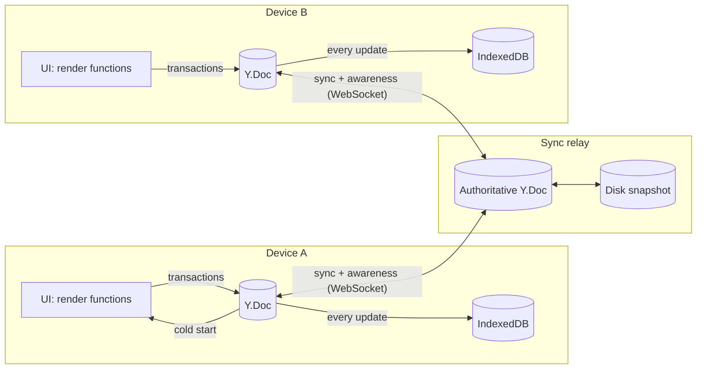

# Architecture

Continuum reconstructs a user's **operational state** — not just their saved data — across devices, crashes, and offline gaps. This document explains how, and why each decision was made.

## The central idea

A normal "synced" app keeps the latest *document* on a server. Reload, and you pull it down. That restores what you made. It does not restore what you were *doing*.

Continuum models three kinds of state and keeps them separate:

```
committed   the saved dashboard            shared, durable, the source of truth
drafts      per-user unsaved edits         survive device switch / crash before "Save"
session     per-user operational state     selection, workflow step, scroll, half-filled forms
```

All three live in one CRDT document, so any device can edit while offline and everything merges deterministically on reconnect. The separation is the point: drafts and session state are what let a *different* device resume the operator mid-task, instead of just reopening the file.

## Data flow



The browser's local document is always the source of truth for that device. IndexedDB makes it durable. The relay is an *accelerator* for sharing — pull the relay out entirely and each device still works, offline, with everything it last knew.

## Module map

```
src/core/
  doc.ts          defines the shared document: meta, widgets, drafts, sessions, log
  identity.ts     user (stable, cross-device) vs device (per-tab) identity
  persistence.ts  IndexedDB wiring; resolves when the local state has loaded
  provider.ts     custom Yjs network provider — sync + awareness + offline lifecycle
  session.ts      captures and reads per-user operational state (the resume engine)
  conflicts.ts    watches for remote edits to fields you just touched; logs the merge
  model.ts        all document mutations as well-formed, single-origin transactions

src/ui/
  context.ts      the surface UI code may touch (state + actions); main.ts implements it
  canvas.ts       the dashboard grid, drag-and-drop
  widget.ts       per-type widget rendering (metric, chart, table, status, note)
  inspector.ts    the editor; stages edits as drafts; binds the Note to a live CRDT text
  palette.ts      widget palette + the resumable "add widget" composer
  chrome.ts       topbar (workflow stepper, presence), status bar, activity drawer, resume banner
  presence.ts     live cursors and avatars from Yjs awareness
  bindText.ts     conflict-free <textarea> ↔ Y.Text binding
  dom.ts          minimal element helpers

server/
  index.ts        WebSocket relay: one Y.Doc per workspace, persisted to disk
main.ts           orchestration: wires document, provider, session, conflicts, and UI
```

## The sync layer (written from scratch)

Rather than use `y-websocket`, the provider (`src/core/provider.ts`) and relay (`server/index.ts`) are built directly on the standard `y-protocols` sync and awareness protocols. This keeps the entire connection lifecycle in the codebase, which matters because offline behaviour is the product.

**Message framing.** Each WebSocket message is a `lib0` varint tag followed by a payload:

- `0` — **sync**: Yjs sync step 1 (a state vector), step 2 (the missing updates), or an incremental update.
- `1` — **awareness**: ephemeral presence (who's here, cursor position), never persisted.

**Why there is no replay queue.** Yjs sync is *state-based*, not operation-based. On every (re)connection a client sends its state vector; the peer replies with only the updates the client lacks. So editing while disconnected needs no fragile outbound queue — when the socket returns, one exchange of state vectors reconciles both sides, in any order, with no lost or duplicated writes. Durability of those offline edits is handled separately, by IndexedDB. This is the single most important design decision in the project: it is what makes "pull the plug and keep working" correct rather than best-effort.

**Reconnection.** The provider reconnects with exponential backoff and jitter, and distinguishes a *dropped* connection (auto-reconnect) from a *user-requested* offline (the demo switch — stays offline until you choose to return). On any disconnect it clears its knowledge of other peers' presence, which is re-learned on reconnect.

**The relay** holds one authoritative `Y.Doc` per workspace, applies the same protocols, rebroadcasts each update to the other connected clients, and snapshots the document to disk (debounced) so the server is durable across restarts too.

## The session / resume engine

`SessionController` (`src/core/session.ts`) writes the local user's operational state into a per-user map in the shared document, debounced. Because it is part of the CRDT, it travels to every device the user opens.

On load, `main.ts` reads the stored snapshot *before* wiring any live writes, then decides:

- **Same tab reloading** (same device id) → apply silently; this is just a refresh.
- **A different device, or a crash-reopen, or unsaved drafts present** → show a resume banner describing exactly where you were, and let you choose to jump there or stay put.

Device identity is per-tab (session storage); user identity is stable (local storage, or `?user=` in the URL). That split is what makes "the same person on two devices" distinguishable from "two people collaborating."

## Conflict resolution

CRDTs resolve concurrent edits deterministically at the data-structure level — no edit is ever rejected, which is why offline work is always safe to merge. Two things make that *visible* rather than silent:

1. The **Note body** is a `Y.Text`. Two people (or one person on two devices) typing into it merge character by character, live. The textarea binding computes a minimal prefix/suffix diff so each keystroke preserves the CRDT's per-character identity instead of replacing the whole string.
2. The **conflict watcher** notices when a remote change lands on a field you edited within the last few seconds and records it in the Activity log, so a merge you'd otherwise never see becomes legible.

## Trade-offs and what's next

- **No framework.** A small hand-written DOM layer keeps the interesting engineering (state, sync, reconstruction) legible and dependency-light. The cost is more manual rendering code; the benefit is that nothing is hidden behind a framework's reconciler.
- **Whole-document disk snapshots** on the server are simple and correct for this scale; an append-only update log would scale better.
- **No auth.** The relay lets any client into any workspace. The `session` layer already models a permission/role field; enforcing it server-side is the natural next step.
- **No session TTL.** Operational state is kept indefinitely; production would expire it.

None of these affect the core demonstration — they are where a production version would continue from here.
